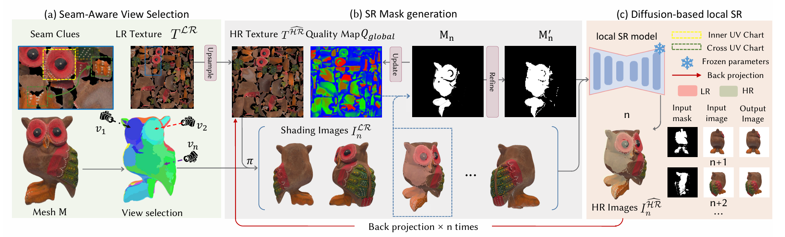

# Texture++: Elevating 3D Asset Texture Resolution with a Region-Aware Diffusion Model

**SIGGRAPH Asia 2026**

Shuaiwei Wang, Shi Li, Jieting Xu, Yuchi Huo, Qi Wang, Wenting Zheng, Rengan Xie

**[Project Page](https://cynic0622.github.io/Texture-pp/)** · **[Paper](https://arxiv.org/abs/2607.21504)** · **[Hugging Face Model](https://huggingface.co/wshw/texture_pp)**

<p align="center">
  
</p>

We present Texture++, a novel framework for texture super-resolution, which enhances the low-resolution textures of assets to produce high-resolution, high-quality results. Specifically, we reformulate the task of super-resolution in UV space into performing it across multiple rendered views and merging the outputs. Firstly, to achieve more complete and continuous textures in the view space, we propose an adaptive view selection strategy to integrate textures dispersed across UV texture patches. Furthermore, we introduce a quadtree-based texture region organization method for combining super-resolved textures from different viewpoints, providing masks to distinguish regions that require improvement. Finally, we design a diffusion-based super-resolution model that enhances the texture resolution for specified masked regions, seamlessly integrating with surrounding regions.

## Usage

```bash
git clone <repo-url>
cd texture_pp
conda create -n texture_pp python=3.10
conda activate texture_pp
pip install -r requirement.txt

# single model (run from the repo root)
python src/main.py -m <model.obj> [-t <tex.png>]

# directory input (the directory must contain <dirname>.obj and <dirname>.png)
python src/main.py -m <model_dir>
```

Key arguments that affect the SR results:

| Argument | Default | Description |
|----------|---------|-------------|
| `--upscale` | `4` | Super-resolution scale factor |
| `--split_curved_angle_deg` | `90.0` | Recursive split threshold (deg) for normal spread within an island |
| `--min_view_extent_ratio` | `0.30` | Lower bound on (island_extent / camera_distance) |
| `--merge_min_face_count` | `200` | An island with fewer faces is candidate for merging into its largest non-small 3D-adjacent neighbour |
| `--merge_min_area_ratio` | `0.02` | Combined with `--merge_min_face_count`: an island whose area is below this fraction of total mesh area AND whose face count is below the threshold is treated as 'small' |
| `--seam_min_strip_vertices` | `8` | Discard seam strips with fewer vertices than this |
| `--seam_split_normal_spread_deg` | `0.0` | If > 0, a seam strip whose surrounding faces span this many degrees of normal direction is split into 2 cameras |
| `--seam_split_max_coherence` | `0.5` | If > 0, a seam strip whose area-weighted normal coherence \|Sum(a_i\*n_i)\|/Sum(a_i) falls below this is split into 2 cameras |
| `--weld_vertex_eps` | `1e-6` | 3D-position welding tolerance (L_inf) |
| `--weld_uv_eps` | `1e-6` | 2D UV-position welding tolerance, analogous to `--weld_vertex_eps` but for UV coords |
| `--use_xatlas_charts` | `True` | Run xatlas after loading the mesh to compute an alternative UV partitioning used ONLY for view-selection island detection |

## Model Files and Weight Paths

Placed under `models/` in the repo root by default (overridable via CLI arguments) available at [Hugging Face](https://huggingface.co/wshw/texture_pp):

| Weight | Default path |
|--------|-------------|
| TextureSRModel | `models/texture_sr_model/` |

## Directory Structure

```
texture_pp/
├── src/
│   ├── main.py              CLI entry
│   ├── pipeline.py          inference loop (super_resolve_texture)
│   ├── config.py            Config
│   ├── io_utils/            OBJ loading, texture loading, image saving
│   ├── geometry/            UV-island / seam view selection
│   ├── rendering/           projection matrix, rasterisation, texture-space LUTs
│   ├── quality/             view quality Q_view, quadtree mask refinement
│   ├── projection/          per-texel gather back-projection
│   └── sr/
│       ├── local.py         LocalSRModel wrapper
│       └── model/           TextureSRModel and SD network definitions
└── requirement.txt
```

## Citation
If you find Texture++ useful, please cite:
```bibtex
@article{wang2026texturepp,
      title={Texture++: Elevating 3D Asset Texture Resolution with a Region-Aware Diffusion Model},
      author={Shuaiwei Wang and Shi Li and Jieting Xu and Yuchi Huo and Qi Wang and Wenting Zheng and Rengan Xie},
      year={2026},
      eprint={2607.21504},
      archivePrefix={arXiv},
      primaryClass={cs.CV},
      url={https://arxiv.org/abs/2607.21504},
}
```


## License

This project is licensed under the MIT License.

